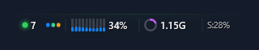
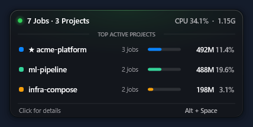
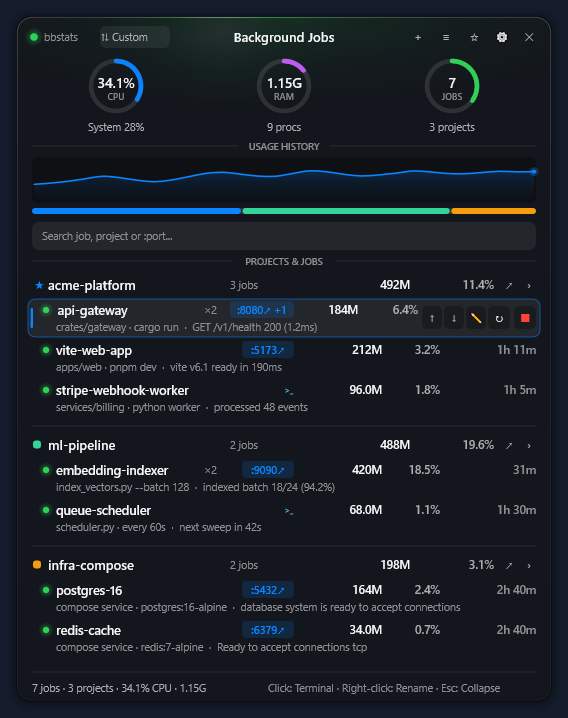
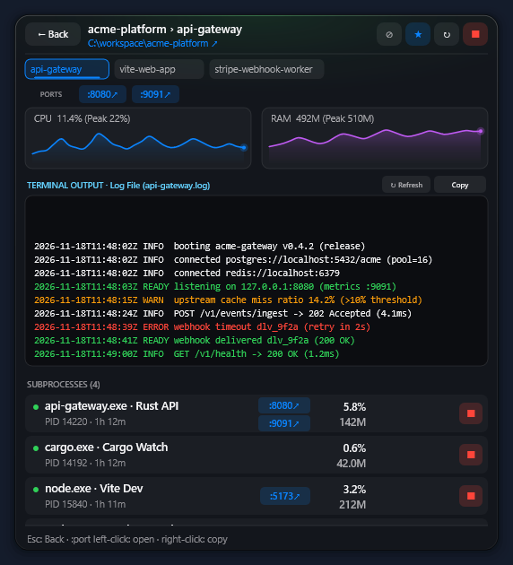
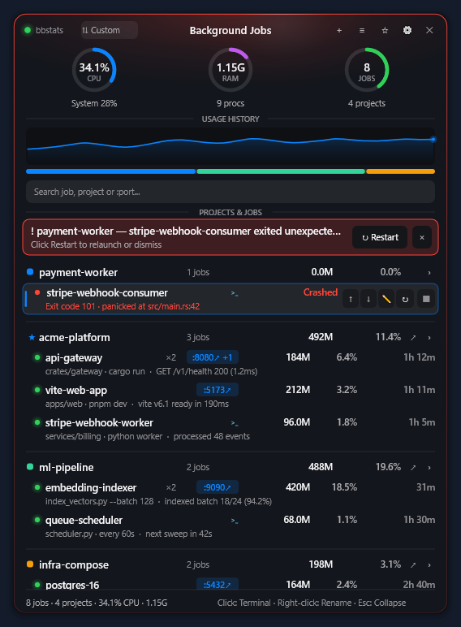
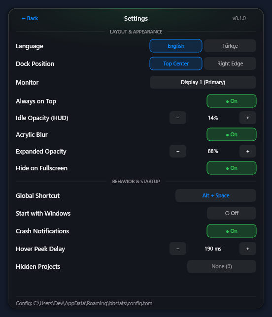

<div align="center">
  
  <h1>bbstats</h1>
  <p><strong>Dynamic Island background process &amp; developer project telemetry monitor</strong></p>
  <p>
    <strong>English</strong> · <a href="README.tr.md">Türkçe</a> · <a href="CHANGELOG.md">Changelog</a>
  </p>
  <p>
    
    
    
    
  </p>
</div>

---

**bbstats** is a lightweight, zero-runtime-dependency Dynamic Island overlay for developers. Instead of drowning you in hundreds of raw OS PIDs like Task Manager or Activity Monitor, it groups your active servers, workers, containers, and scheduled jobs by **project** and **logical workload**—showing live CPU/RAM curves, bound ports, log streams, crash alerts, and one-click safe controls.

## Screenshots

<div align="center">
  <p><strong>Collapsed Pill &amp; Hover Peek</strong></p>
  
  <br /><br />
  
</div>

<br />

<div align="center">
  <table>
    <tr>
      <td align="center" width="50%">
        <strong>Expanded Panel &amp; Live Sparklines</strong><br />
        
      </td>
      <td align="center" width="50%">
        <strong>Job Detail, Logs &amp; Subprocesses</strong><br />
        
      </td>
    </tr>
    <tr>
      <td align="center" width="50%">
        <strong>Crash Alert &amp; Status Ambient Glow</strong><br />
        
      </td>
      <td align="center" width="50%">
        <strong>Settings (EN / TR Switcher)</strong><br />
        
      </td>
    </tr>
  </table>
</div>

---

## Why bbstats? (vs. Task Manager & Classic Tools)

| Feature / Workflow | Windows Task Manager / Classic Monitors | **bbstats** |
|---|---|---|
| **Primary View** | Hundreds of flat raw PIDs (`node.exe`, `python.exe`, `cmd.exe`) | **Projects & Logical Jobs:** Resolves `package.json`, `Cargo.toml`, `pyproject.toml`, `.git`, Docker Compose (`acme-platform › api-gateway`) |
| **Wrapper Noise** | `cmd.exe`, `conhost.exe`, and venv shims clutter separate rows | Collapses parent wrappers and helper trees into a single job row (`×2`, `×3`) |
| **Bound Ports (`:port↗`)** | Requires manual `netstat -ano` correlation | Inline clickable `:port↗` chips right on every job (left-click opens browser, right-click copies URL) |
| **Crash Recovery** | Crashed processes vanish silently | Keeps `"Crashed"` card visible with exit code, fires notification, supports one-click `↻ Restart` and bounded `auto_restart` |
| **Live Logs** | Must hunt for buried terminal windows or open log files manually | Built-in live log, pipe, console buffer, and state-JSON viewer with `INFO`/`WARN`/`ERROR` highlighting |
| **Desktop Footprint** | Heavy standalone window requiring `Alt+Tab` | Always-accessible **Dynamic Island** capsule (top-center or right rail), auto-hides in fullscreen |

---

## Key Features

- **Dynamic Island Ergonomics:** Critically-damped spring physics (`60–120fps`), cursor-tracking top-rim specular reflection, status-aware top ambient glow (green/amber/crimson), and cascaded list/tab micro-transitions.
- **Project & Job Grouping:** Automatically resolves workspace roots (`package.json`, `Cargo.toml`, `pyproject.toml`, `.git`, Docker Compose) and collapses wrapper/trampoline processes (`cmd`, `conhost`, `venv` shims) into clean readable jobs.
- **Live Telemetry & Ports:** Per-project CPU/RAM sparklines with smoothed Catmull-Rom cubic Bezier curves, stacked project RAM allocation bar, clickable `:port↗` chips (left-click opens browser, right-click copies URL).
- **Terminal & Log Inspection:** Lazy tailing of live managed pipes, log files, CLI `stdout` redirects, structured state JSON files, or classic console buffers with severity highlighting.
- **Crash Detection & Bounded Auto-Restart:** Instant toast/banner notifications on unexpected non-zero exit codes, manual one-click `↻ Restart`, and optional bounded `auto_restart` (max 3 attempts per 10 minutes).
- **Privacy & Safety First:** Built-in CLI secret redaction (`--token`, `--api-key`, basic auth URLs) and strict process blacklist protection so system/self processes can never be killed accidentally.

---

## Platform Support

| Platform | Status | Interface & Rendering | Telemetry & Autostart |
|---|---|---|---|
| **Windows 10 / 11 (`x86_64`)** | Supported (`v0.1.0`) | Direct3D11 + Direct2D + DirectWrite + WinRT Composition (`WS_EX_TOOLWINDOW`, Acrylic backdrop) | NT PEB inspection, IP Helper TCP/UDP ports, Tray `Shell_NotifyIconW`, Registry Run |
| **macOS (`arm64` / `x86_64`)** | Supported (`v0.1.0`) | Native ANSI Dynamic Island live terminal HUD (`bbstats`, `--watch`, `--status`, `--dump-snapshot`) | `ps` / `sysctl` / `vm_stat` / `lsof` port & CWD telemetry, `SIGTERM`→`SIGKILL`, Docker Unix socket, `~/Library/LaunchAgents` |

---

## Build & Run

**Prerequisites:** Rust toolchain (`stable`). No Node/Electron or external runtime required (`build.rs` embeds the **`bb`** `.ico` & Win32 resources on Windows automatically).

### Windows

```powershell
# Run clippy checks & unit tests
cargo clippy --all-targets -- -D warnings
cargo test --no-fail-fast

# Build optimized release executable (target\release\bbstats.exe)
cargo build --release
```

### macOS (`arm64` / `x86_64`)

```bash
# Run clippy checks & unit tests
cargo clippy --all-targets -- -D warnings
cargo test --no-fail-fast

# Build & run live Dynamic Island terminal HUD
cargo run --release -- --watch

# Single-shot overview or plain snapshot dump
./target/release/bbstats --status
./target/release/bbstats --dump-snapshot
```

---

## CLI Diagnostic & Screenshot Flags

Without disturbing a running instance, you can inspect telemetry or render showcases directly from the CLI:

```powershell
# Print live detected projects, jobs, ports, and last log lines to stdout (Windows & macOS)
bbstats --dump-snapshot

# Single-shot formatted HUD table (macOS)
bbstats --status

# Render deterministic clean showcase screenshots to out\shots (--lang en | tr, Windows)
.\target\release\bbstats.exe --dump-shot out\shots --lang en

# Render screenshots using your live running processes (Windows)
.\target\release\bbstats.exe --dump-shot out\shots --live
```

---

## Configuration

### `config.toml`
- **Windows:** `%APPDATA%\bbstats\config.toml`
- **macOS:** `~/Library/Application Support/bbstats/config.toml`

Managed via the in-app **Settings** panel (Windows) or directly in TOML:

```toml
language = "en"                 # "en" | "tr"
dock_position = "top_center"    # "top_center" | "right_edge"
monitor_index = 0
always_on_top = true
acrylic_enabled = true
idle_opacity = 0.14             # 0.0 (transparent HUD) .. 0.95
glass_opacity = 0.88            # 0.25 .. 0.98
hide_on_fullscreen = true
notify_on_crash = true
hover_peek_delay_ms = 190
autostart = false
hotkey = "alt_space"            # "alt_space" | "ctrl_shift_p"
sort_mode = "custom"            # "custom" | "cpu" | "ram" | "name" | "uptime"
pinned_projects = []
hidden_projects = []
```

### Custom Project Rules (`labels.toml`)
- **Windows:** `%APPDATA%\bbstats\labels.toml`
- **macOS:** `~/Library/Application Support/bbstats/labels.toml`

Define custom naming rules, JSON PID/state file bindings (`pid_file`), workspace directory scanners (`scan_dir`), scheduled task / LaunchAgent monitors (`scheduled_task`), and bounded `auto_restart` policies using [`assets/labels.example.toml`](assets/labels.example.toml).

---

## Keyboard & Mouse Shortcuts

| Shortcut / Action | Behavior |
|---|---|
| `Alt+Space` / `Ctrl+Shift+P` | Toggle Dynamic Island expand / collapse (configurable in Settings) |
| `↑` / `↓` + `Enter` or `→` | Navigate job rows / Open Detail view |
| `Esc` / `←` | Clear search / Back to overview / Collapse |
| `/` | Focus search bar |
| `Alt+P` / `Alt+K` | Pin/unpin selected project / Request stop confirmation for selected job |
| `Delete` (on selected row) | Request stop confirmation for selected job |
| `Ctrl+Backspace`, `Ctrl+A`, `Ctrl+U`, `Ctrl+C`, `Ctrl+V` | Fast text editing in Search, Rename, and Add Job inputs |
| `:port↗` Left click / Right click | Open URL in browser / Copy URL to clipboard |
| Right click project or job row | Inline rename saved to `labels.toml` |

---

## Architecture Overview

- `src/platform/` — Borderless overlay window loop, system tray **`bb`** icon & crash balloons, PerMonitorV2 DPI & monitor geometry, fullscreen detection, global hotkey.
- `src/engine/` — Single background telemetry thread (`collector`, `win_nt`), project & job inference pipeline (`project_resolver/`), user rules & watchers (`labels`, `known_jobs`), snapshot builder (`snapshot`), log tailing (`terminal`), and safe termination/restart (`actions`).
- `src/render/` — Direct3D11 + Direct2D1 + DirectWrite + WinRT Composition pipeline, theme tokens (`theme`), glass/Bezier primitives (`primitives`), and offscreen PNG exporter (`shot`).
- `src/ui/` — Critically-damped springs (`spring`), viewport/stagger math (`layout`), hit regions (`hit_test`), and views (`views/`).

---

## Contributing & License

Contributions across Windows and macOS (native telemetry, AppKit Notch HUD enhancements, resolvers, and localization) are warmly welcome! Open an issue or PR after verifying:

```powershell
cargo clippy --all-targets -- -D warnings
cargo test --no-fail-fast
```

See the release history in [`CHANGELOG.md`](CHANGELOG.md). Licensed under the [MIT License](LICENSE).
