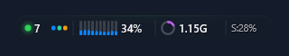
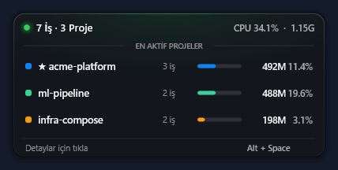
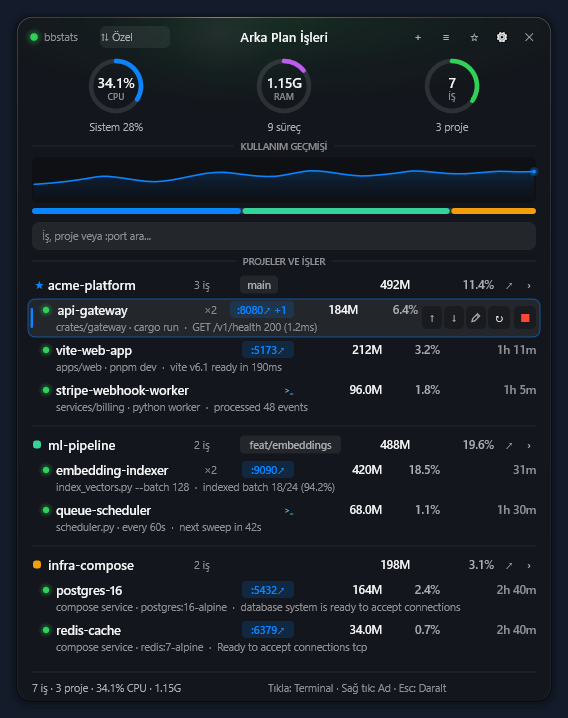
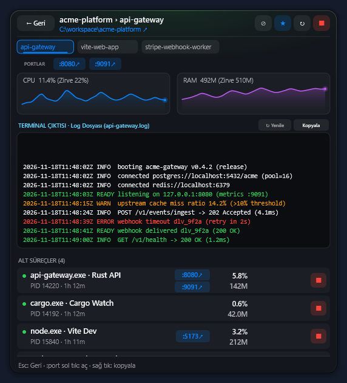
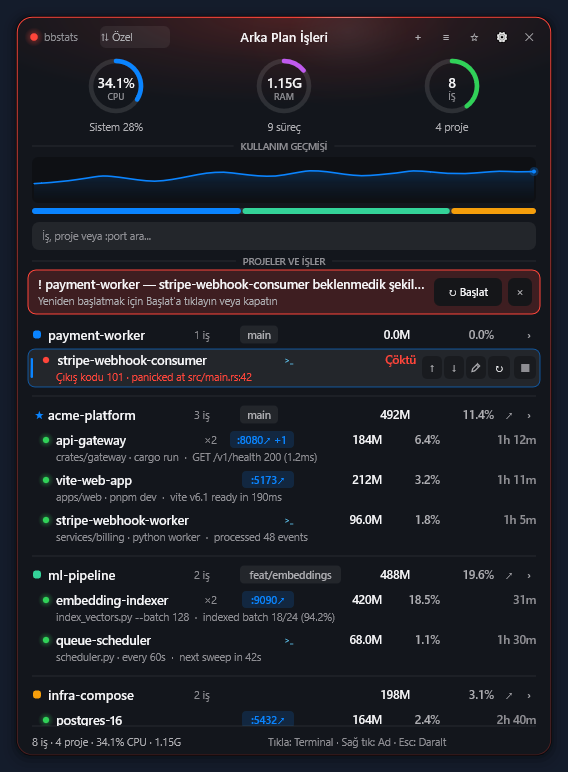
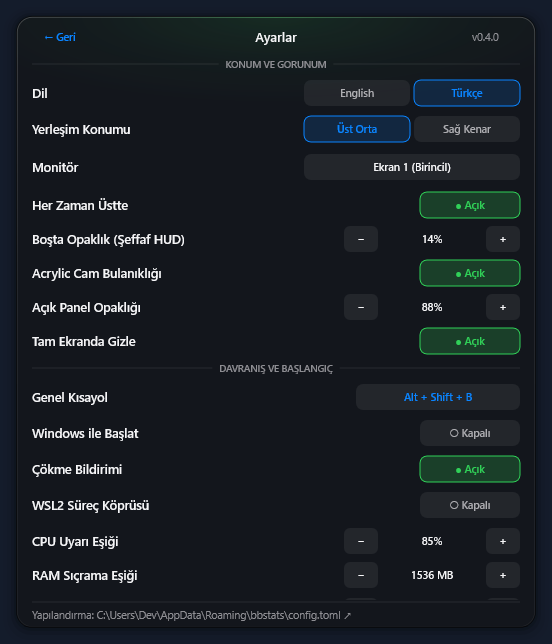

<div align="center">
  
  <h1>bbstats</h1>
  <p><strong>Dynamic Island tarzı arka plan süreç ve geliştirici proje telemetri monitörü</strong></p>
  <p>
    <a href="README.md">English</a> · <strong>Türkçe</strong> · <a href="CHANGELOG.md">Değişiklik Günlüğü</a> · <a href="SECURITY.md">Güvenlik</a> · <a href="CONTRIBUTING.md">Katkıda Bulun</a>
  </p>
  <p>
    
    
    
    
    
  </p>
</div>

---

**bbstats**, geliştiriciler için sıfır harici çalışma zamanı bağımlılığına sahip, **%100 yerel (sıfır telemetri, sıfır bulut bağlantısı)** Dynamic Island masaüstü monitörü ve geliştirici süreç aracıdır. Görev Yöneticisi veya Etkinlik Monitörü gibi yüzlerce ham işletim sistemi PID'si göstermek yerine; aktif sunucularınızı, worker'larınızı, konteynerlerinizi ve zamanlanmış işlerinizi **proje** ve **mantıksal iş** bazında gruplar, canlı CPU/RAM eğrilerini, portları, log akışlarını ve güvenli kontrol düğmelerini tek merkezde sunar.

> **%100 Yerel ve Gizlilik Odaklı:** `bbstats` hiçbir analiz verisi, çökme raporu veya ağ isteği göndermez. Tüm izleme makinenizde yerel kalır (Docker sorguları yalnızca Docker çalışırken yerel soket/pipe üzerinden yapılır).

## İndirme ve Kurulum

### Hazır İkili Paketler (GitHub Releases)

**Windows (`x86_64`)**, **macOS (`arm64` / `x86_64`)** ve **Linux (`x86_64`)** için en son sürüm arşivini [GitHub Releases](https://github.com/F0Rextasy/bbstats/releases) sayfasından indirebilirsiniz. Her sürümde bütünlüğü doğrulamak için `SHA256SUMS.txt` ve GitHub build-provenance doğrulamaları yer alır.

> **Windows SmartScreen Notu:** Sürüm ikilileri henüz kurumsal kod imzalama sertifikasıyla imzalanmadığı için ilk çalıştırmada Windows SmartScreen uyarısı çıkabilir; çalıştırmadan önce arşivin SHA-256 özetini `SHA256SUMS.txt` ile doğrulayabilirsiniz.

### Kaynaktan Kurulum (`cargo`)

```bash
cargo install --git https://github.com/F0Rextasy/bbstats.git --locked
```

## Ekran Görüntüleri

<div align="center">
  <p><strong>Daraltılmış Kapsül &amp; Hover Önizleme</strong></p>
  
  <br /><br />
  
</div>

<br />

<div align="center">
  <table>
    <tr>
      <td align="center" width="50%">
        <strong>Genişletilmiş Panel, Git Branch Rozetleri &amp; Canlı Eğriler</strong><br />
        
      </td>
      <td align="center" width="50%">
        <strong>İş Detayı, Log Akışı &amp; İşe Özgü Alt Süreçler</strong><br />
        
      </td>
    </tr>
    <tr>
      <td align="center" width="50%">
        <strong>Çökme Uyarısı &amp; Duruma Duyarlı Parıltı</strong><br />
        
      </td>
      <td align="center" width="50%">
        <strong>Ayarlar (v0.2.1, TR / EN Dil Seçimi)</strong><br />
        
      </td>
    </tr>
  </table>
</div>

---

## Neden bbstats? (Görev Yöneticisi ve Klasik Araçlardan Farkı)

| Özellik / İhtiyaç | Windows Görev Yöneticisi / Klasik Araçlar | **bbstats** |
|---|---|---|
| **Görünüm Birimi** | Yüzlerce ham PID satırı (`node.exe`, `python.exe`, `cmd.exe`) | **Proje ve Mantıksal İş (Job):** `package.json`, `Cargo.toml`, `pyproject.toml`, `.git`, Docker Compose köklerini tanıyarak gruplar (`acme-platform › api-gateway`) |
| **Sarmalayıcı Gürültüsü** | `cmd.exe`, `conhost.exe` ve venv başlatıcıları ayrı ayrı kalabalık yapar | Üst sarmalayıcıları ve alt süreç ağacını tek okunaklı iş satırında (`×2`, `×3`) toplar |
| **Port Takibi (`:port↗`)** | Elle `netstat -ano` çalıştırmayı gerektirir | Her iş ve alt süreçte canlı `:port↗` çipleri (sol tık tarayıcıda açar, sağ tık URL kopyalar) |
| **Çökme Tespiti & Kurtarma** | Çöken süreç listeden sessizce kaybolur | Çıkış kodunu yakalar, `"Çöktü"` rozeti ve uyarı gösterir, tek tık `↻ Restart` ve sınırlı `auto_restart` sunar |
| **Canlı Log İzleme** | Arka plandaki log dosyasını veya konsolu ayrıca bulup açmak gerekir | Dahili log, pipe, konsol tamponu ve state-JSON görüntüleyici (`INFO`/`WARN`/`ERROR` renklendirmesiyle) |
| **Masaüstü Ergonomisi** | Ayrı pencere (`Alt+Tab` gerektirir) | Ekran üst ortasında veya sağ kenarda **Dynamic Island** kapsülü; tam ekranda otomatik gizlenir |

---

## Temel Özellikler

- **Dynamic Island Akıcılığı:** Kritik sönümlü yay fiziği (`60–120fps`), imleç takipli üst kenar cam parlaması, duruma duyarlı üst ortam parıltısı (yeşil/amber/kırmızı) ve basamaklı satır/sekme mikro-geçişleri.
- **Proje ve İş Odaklı Gruplama:** Çalışma dizini köklerini (`package.json`, `Cargo.toml`, `pyproject.toml`, `.git`, Docker Compose) otomatik çözümler; `cmd`, `conhost`, `venv` gibi sarmalayıcı süreçleri tek anlamlı iş satırı altında toplar.
- **Canlı Telemetri & Portlar:** Catmull-Rom kübik Bezier sparkline grafikleri, proje bazlı RAM paylaşım çubuğu ve tıklanabilir `:port↗` çipleri (sol tık tarayıcıda açar, sağ tık URL kopyalar).
- **Terminal & Log İnceleme:** Yönetilen pipe akışları, log dosyaları, yönlendirilmiş konsol çıktıları, state JSON dosyaları ve klasik conhost tamponlarını önem derecesine göre renklendirerek gösterir.
- **Çökme Bildirimi & Sınırlı Otomatik Yeniden Başlatma:** Beklenmedik çıkışlarda tepsi ve banner uyarısı, tek tık `↻ Restart` ve isteğe bağlı `auto_restart` (10 dakikada en fazla 3 deneme).
- **Gizlilik ve Güvenlik:** Komut satırındaki gizli anahtarları (`--token`, `--api-key`, kimlik bilgisi içeren URL'ler) otomatik maskeler; kritik işletim sistemi süreçlerinin sonlandırılmasını kara liste ile engeller.

---

## Platform Desteği

| Platform | Durum | Arayüz ve Grafik Katmanı | Telemetri ve Başlangıç |
|---|---|---|---|
| **Windows 10 / 11 (`x86_64`)** | Destekleniyor | Direct3D11 + Direct2D + DirectWrite + WinRT Composition Dynamic Island kapsülü (`WS_EX_TOOLWINDOW`, Acrylic cam) | NT PEB okuma, IP Helper TCP/UDP portları, `Shell_NotifyIconW`, Registry Run |
| **macOS (`arm64` / `x86_64`)** | Destekleniyor | Çapraz platform canlı ANSI terminal HUD (`bbstats`, `--watch`, `--status`, `--daemon`) + CLI araçları | `ps` / `sysctl` / `vm_stat` / `lsof` port ve CWD tarama, `kqueue` çökme izleyici, Docker Unix soketi, `~/Library/LaunchAgents` (`--autostart`) |
| **Linux (`x86_64`)** | Destekleniyor | Çapraz platform canlı ANSI terminal HUD (`bbstats`, `--watch`, `--status`, `--daemon`) + CLI araçları | `/proc` CPU/RAM/CMD/CWD ve `lsof` port tarama, Docker soketi, XDG `.desktop` başlangıç (`--autostart`) |

---

## Derleme ve Çalıştırma

**Ön koşullar:** Rust toolchain (`>= 1.88`). Harici Node/Electron veya ek çalışma zamanı gerekmez; Windows'ta `build.rs` gömülü **`bb`** `.ico` ve Win32 kaynağını doğrudan üretir.

### Windows

```powershell
# Clippy denetimi ve tüm birim testleri
cargo clippy --all-targets --all-features -- -D warnings
cargo test --all-features --no-fail-fast

# Release ikilisini derle (target\release\bbstats.exe)
cargo build --release --locked
```

### macOS & Linux

```bash
# Clippy denetimi ve tüm birim testleri
cargo clippy --all-targets --all-features -- -D warnings
cargo test --all-features --no-fail-fast

# Canlı ANSI terminal HUD'unu derle ve çalıştır
cargo run --release -- --watch

# Tek seferlik özet, daemon veya başlangıçta otomatik başlatma
./target/release/bbstats --status
./target/release/bbstats --daemon
./target/release/bbstats --autostart on
```

---

## Geliştirici CLI Komutları ve Tanı Bayrakları

Çalışan masaüstü kapsülünü etkilemeden komut çalıştırabilir, portları inceleyebilir veya proje işlerini doğrudan başlatabilirsiniz:

```powershell
# Mevcut ortam değişkenlerini koruyarak ve canlı çıktıyı akıtarak komut çalıştır
bbstats run -- npm run dev
bbstats run --cwd ./api -- cargo run

# Belirtilen portu dinleyen proje, iş, PID ve komutu göster (isteğe bağlı güvenli sonlandır)
bbstats port 3000
bbstats port 3000 --kill

# bbstats.toml, Procfile veya package.json script'lerinden işleri listele veya başlat
bbstats launch --list
bbstats launch ./projem

# Algılanan canlı projeleri, işleri, portları ve son logları stdout'a bas
bbstats --dump-snapshot

# Tek seferlik HUD tablosu, daemon veya login başlangıç ayarı (macOS & Linux)
bbstats --status
bbstats --daemon
bbstats --autostart on

# Sürüm bilgisini veya CLI yardımını yazdır
bbstats --version
bbstats --help

# Kişisel veri içermeyen deterministik demo ekran görüntülerini üret (--lang tr | en, Windows)
cargo run --features screenshots -- --dump-shot out\shots --lang tr

# Canlı makine süreçleriyle ekran görüntüsü üret (Windows)
cargo run --features screenshots -- --dump-shot out\shots --live
```

---

## Yapılandırma

### `config.toml`
- **Windows:** `%APPDATA%\bbstats\config.toml`
- **macOS:** `~/Library/Application Support/bbstats/config.toml`
- **Linux:** `~/.config/bbstats/config.toml`

Uygulama içi **Ayarlar** ekranından (Windows) veya doğrudan TOML dosyasından düzenlenebilir:

```toml
language = "tr"                 # "en" | "tr"
dock_position = "top_center"    # "top_center" | "right_edge"
monitor_index = 0
always_on_top = true
acrylic_enabled = true
idle_opacity = 0.14             # 0.0 (şeffaf HUD) .. 0.95
glass_opacity = 0.88            # 0.25 .. 0.98
hide_on_fullscreen = true
notify_on_crash = true
hover_peek_delay_ms = 190
autostart = false
hotkey = "alt_shift_b"          # "alt_shift_b" | "ctrl_alt_b" | "alt_space" | "ctrl_shift_p" | "disabled"
sort_mode = "custom"            # "custom" | "cpu" | "ram" | "name" | "uptime"
pinned_projects = []
hidden_projects = []
```

### Özel Proje Kuralları (`labels.toml`)
- **Windows:** `%APPDATA%\bbstats\labels.toml`
- **macOS:** `~/Library/Application Support/bbstats/labels.toml`
- **Linux:** `~/.config/bbstats/labels.toml`

Özel proje adlandırma, `pid_file` durum dosyası bağlama, dizin tarama (`scan_dir`), Görev Zamanlayıcı / LaunchAgent izleme (`scheduled_task`) ve sınırlı `auto_restart` kuralları için [`assets/labels.example.toml`](assets/labels.example.toml) şablonunu kullanabilirsiniz.

---

## Klavye ve Fare Kısayolları

*(Overlay içi klavye kısayolları yalnızca kapsül kısayol veya tıklamayla odaklandığında etkindir; IDE veya terminal kısayollarınızı ezmez.)*

| Kısayol / Eylem | İşlev |
|---|---|
| `Alt+Shift+B` *(varsayılan)* | Dynamic Island panelini aç / daralt (Ayarlar'dan değiştirilebilir: `Ctrl+Alt+B`, `Alt+Space`, `Ctrl+Shift+P`, `Devre Dışı`) |
| `↑` / `↓` + `Enter` veya `→` | İş satırlarında gezin / Detay görünümünü aç (`Enter` açık öldürme onayını da onaylar) |
| `Esc` / `←` / `Backspace` *(Detay/Ayarlar)* | Aramayı temizle / Üst görünüme dön / Daralt |
| `/` | Arama kutusuna odaklan |
| `Alt+P` / `Alt+K` | Seçili projeyi sabitle / Seçili işi durdurmak için onay iste |
| `Delete` (satır seçiliyken) | Seçili işi durdurmak için onay iste |
| `Ctrl+Backspace`, `Ctrl+A`, `Ctrl+U`, `Ctrl+C`, `Ctrl+V` | Arama / Ad Değiştir / İş Ekle alanlarında hızlı metin düzenleme |
| `:port↗` sol tık / sağ tık | Tarayıcıda aç / URL'yi panoya kopyala |
| Proje veya iş satırına sağ tık | Satır içi yeniden adlandırma (`labels.toml` dosyasına kaydedilir) |

---

## Mimari Özeti

- `src/platform/` — Çerçevesiz overlay pencere döngüsü, tepsi **`bb`** ikonu & çökme bildirimleri, PerMonitorV2 DPI / monitör geometrisi, tam ekran tespiti ve genel kısayollar.
- `src/engine/` — Tek arka plan iş parçacığında periyodik tarama (`collector`, `win_nt`), proje/iş çözümleme (`project_resolver/`), kullanıcı kuralları (`labels`, `known_jobs`), snapshot üretimi (`snapshot`), terminal çıktı takibi (`terminal`) ve güvenli sonlandırma/yeniden başlatma (`actions`).
- `src/render/` — Direct3D11 + Direct2D1 + DirectWrite + WinRT Composition boru hattı, tema sabitleri (`theme`), cam/Bezier çizim yardımcıları (`primitives`) ve başsız PNG dışa aktarma (`shot`).
- `src/ui/` — Kritik sönümlü yay animasyonları (`spring`), görünüm boyutlandırma/basamaklama (`layout`), tıklama haritası (`hit_test`) ve arayüz görünümleri (`views/`).
- `src/cli.rs` — Geliştirici CLI komutları (`run`, `port`, `launch`).

---

## Katkıda Bulunma, Güvenlik ve Lisans

Windows, macOS ve Linux platformlarındaki tüm katkılar memnuniyetle karşılanır! Katkı adımları için [`CONTRIBUTING.md`](CONTRIBUTING.md), gizlilik ve güvenlik bildirimi için [`SECURITY.md`](SECURITY.md) dosyalarına göz atabilirsiniz.

Sürüm geçmişi için [`CHANGELOG.md`](CHANGELOG.md) dosyasına bakabilirsiniz. [MIT Lisansı](LICENSE) altında açık kaynaklıdır.
